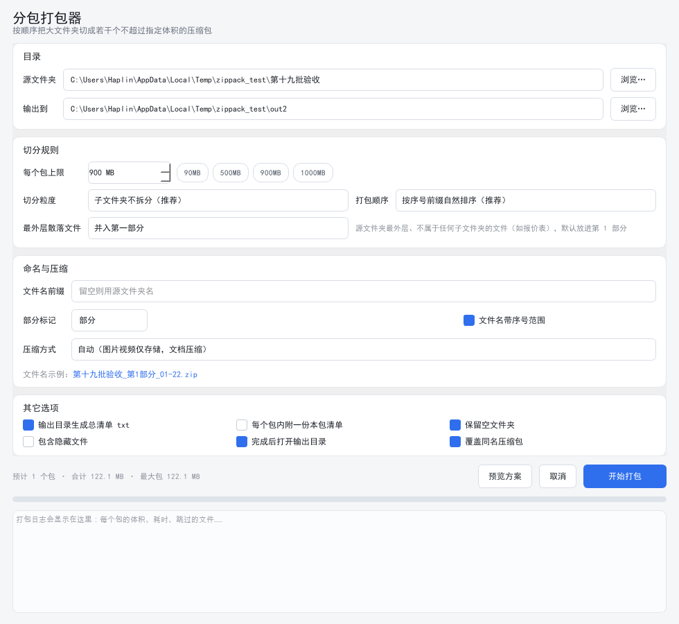

# 分包打包器 · Zip Part Splitter

把一个大文件夹，按**指定的单包体积上限**、**按顺序**切成若干个 zip —— 专门解决「微信/邮件单个文件有大小限制，但文件夹太大发不出去」的问题。

*A tiny Windows GUI tool that splits a big folder into ordered zip parts under a size limit. Handy for WeChat / email attachments.*



## 它解决的问题

微信单文件上限 1GB（某些场景甚至只有 100MB），一个 4GB 的照片文件夹根本发不出去。
常规压缩软件的「分卷」是把**一个压缩包**切成 .001/.002 之类的碎片，收件人必须凑齐所有分卷才能解压，也没法通过微信传。
这个工具切出来的是**若干个各自独立、能单独解压的 zip**，收件人收到第 1 个就能先看，缺哪个再单独要。

## 特性

| 能力 | 说明 |
| --- | --- |
| 按序号顺序切分 | 默认把文件夹名前面的数字当数字比大小（`1, 2, 10` 而不是 `1, 10, 2`），切出来的包天然按业务顺序排列 |
| 子文件夹不拆分 | 一个子文件夹整体进同一个包，照片不会被切到两个包里 |
| 超限兜底 | 若某个子文件夹自身就超过上限，则独占一包并允许超额（保证完整性），预览中标红提示 |
| 严格模式 | 也可以切换为「严格按体积拆分」，包体积精确可控 |
| 最外层散落文件 | 直接躺在源文件夹里、不属于任何子文件夹的文件（如报价表 xlsx），默认并入第 1 部分；也可单独打包或忽略 |
| 智能压缩 | jpg/mp4 等已压缩格式走“仅存储”（快、体积几乎不变），xlsx/pdf/docx 才真正 deflate。4GB 照片约 30 秒完成 |
| 命名可定制 | `第N部分` / `第N批` / `第N卷` / `PART N`，可带序号范围（`_01-22`），方便收件人核对缺没缺 |
| 清单 | 输出目录生成总清单 txt；可选在每个包内也放一份本包清单 |
| 其它 | 保留空文件夹、跳过隐藏文件、覆盖同名包、完成后打开目录、取消/续传式清理 |

## 使用

### 方式一：直接用 exe（推荐）

到 [Releases](../../releases) 下载 `分包打包器.exe`，双击运行。单文件绿色版，**不需要安装 Python 或任何运行库**。

> 首次启动会停顿 1–2 秒（单文件版解压自身），属正常现象。
> 个别杀毒软件会对 PyInstaller 打包的 exe 误报，加白名单即可，或按方式二从源码运行。

操作流程：选源文件夹 → 选输出目录 → 设单包上限 → **预览方案** 看每包大小与序号范围 → 开始打包。

### 方式二：从源码运行

```bash
pip install PySide6
python zippack_gui.py
```

### 命令行

`zippack_core.py` 是纯标准库实现，可独立当 CLI 用（不需要 PySide6）：

```bash
# 只看方案，不真正打包
python zippack_core.py --src "D:\项目资料" --limit 900 --dry-run

# 实际打包
python zippack_core.py --src "D:\项目资料" --limit 900 --out "D:\输出"

# 散落文件单独打一个包，压缩方式用标准压缩
python zippack_core.py --src "D:\项目资料" --limit 900 --loose separate --compress normal
```

| 参数 | 取值 | 默认 |
| --- | --- | --- |
| `--limit` | 每个包上限，单位 MB | `900` |
| `--sort` | `auto` / `name` / `mtime` / `none` | `auto` |
| `--split` | `dir`（子文件夹不拆分）/ `file`（严格按体积） | `dir` |
| `--loose` | `first` / `separate` / `skip` | `first` |
| `--compress` | `auto` / `store` / `normal` / `max` | `auto` |
| `--label` | 部分 / 批 / 卷 / PART | `部分` |
| `--prefix` | 文件名前缀 | 源文件夹名 |
| `--no-range` | 文件名不带序号范围 | 关闭 |
| `--dry-run` | 只输出方案 | 关闭 |

## 从源码构建 exe

```bash
pip install PySide6 pyinstaller
python -m PyInstaller --noconfirm --clean --onefile --windowed \
  --name "分包打包器" --icon icon.ico zippack_gui.py
```

Windows 上也可以直接双击 `build_exe.bat`。

构建产物可用自检模式验证是否完整（构建窗口、加载 Qt 插件、跑一次真实打包，无需人工点击）：

```bash
"dist/分包打包器.exe" --selftest
# 结果写入 %TEMP%\分包打包器_selftest.log
```

## 项目结构

```
zippack_core.py   核心逻辑：扫描、排序、装箱切分、打包（纯标准库，可当 CLI）
zippack_gui.py    PySide6 界面：选项面板、预览表、进度与日志、--selftest 自检
build_exe.bat     一键构建 exe
icon.ico          应用图标
docs/             截图
```

## 常见问题

**微信还是提示文件过大？**
部分版本/场景下微信 PC 端单文件限制会降到 100MB 左右，把上限改成 90MB 重新打一次。

**对方解压后中文乱码？**
压缩包内文件名按 UTF-8 写入，Win10/11 自带解压、7-Zip、WinRAR、Bandizip 均正常；很老的解压软件请改用 7-Zip。

**为什么包的数量比预期多？**
因为默认不拆分文件夹：上限 900MB 时，前 5 个文件夹共 850MB，第 6 个 100MB 就只能挪到下一包。
想塞得更紧就用「严格按体积拆分」。

**日志提示“跳过 N 个文件”？**
通常是文件被其它程序占用（Excel、图片预览等），关闭后重试；日志里会写具体文件名。

## License

[MIT](LICENSE)
